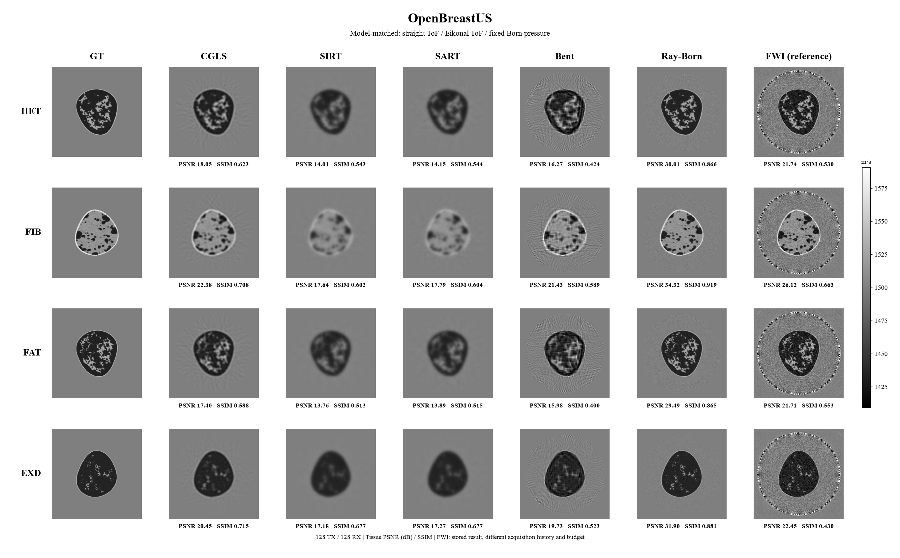
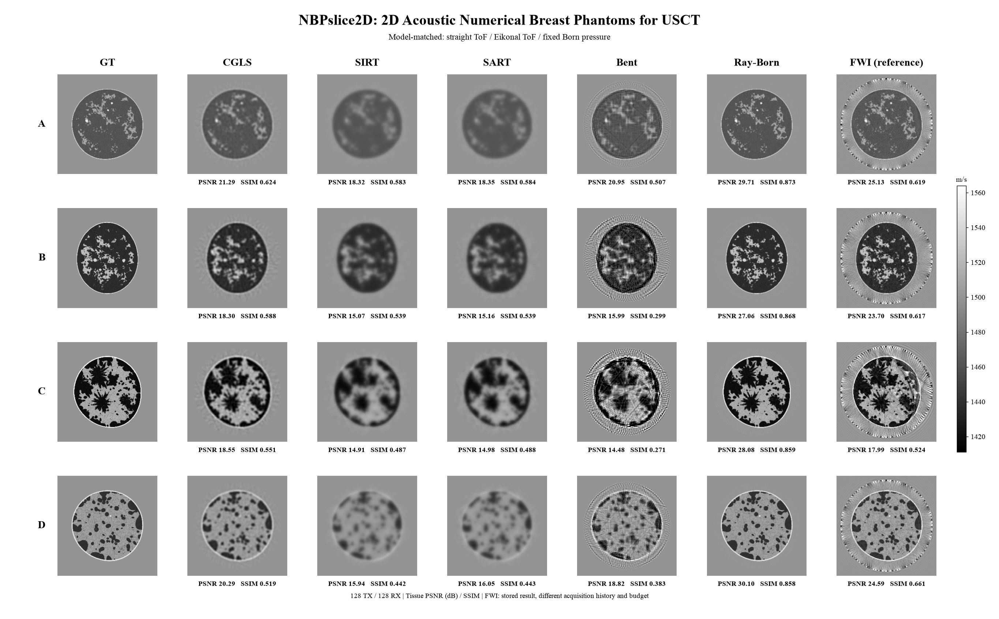
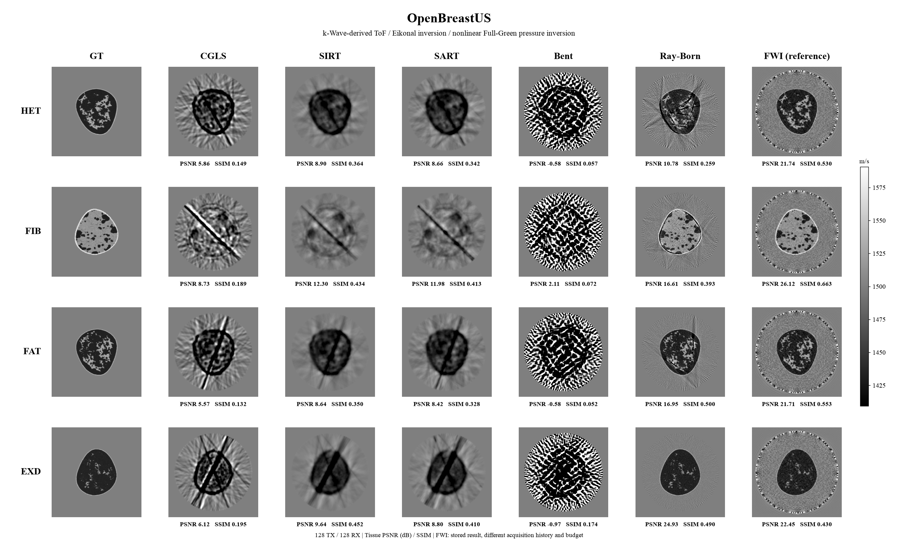
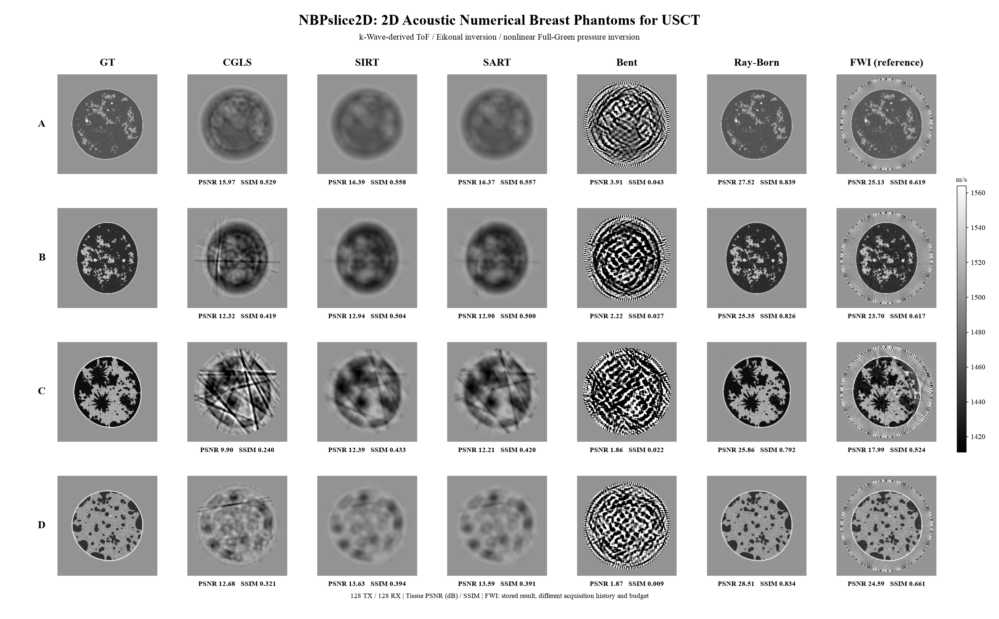

# usct-benchlab

[中文](README.zh-CN.md)

**A numerical reconstruction and benchmarking library for two-dimensional ultrasound computed tomography (USCT).**

`usct-benchlab` reconstructs sound speed from travel times and complex pressure measurements. It brings together physical operators, iterative solvers, data preparation and evaluation through a common case format. Researchers and inverse-problem agents use the same algorithms through the command line or Python API.

The project works with two complementary repositories:

| Repository | Role |
| --- | --- |
| **usct-benchlab** | Algorithm discovery, ray and Born reconstruction, common data handling, execution budgets and benchmark suites |
| [**WaveformInversionUST**](https://github.com/lucian-dw/WaveformInversionUST) | Standalone MATLAB/CUDA frequency-domain FWI runtime, connected to BenchLab through `fwi_wust` |

Start with [installation and quickstart](#installation-and-quickstart), explore the [repository structure](#repository-structure), or connect an [agent](#agent-integration).

## Algorithms

All algorithms produce a sound-speed image in m/s. Straight-ray methods estimate the slowness perturbation $\delta s=1/c-1/c_0$, where $c_0$ is the reference speed. Bent-ray and WUST use slowness $s=1/c$; Born uses squared slowness $m=1/c^2$.

| Algorithm ID | Observations | Model and solver | Configuration |
| --- | --- | --- | --- |
| `straight_cgls` | Water-relative travel times | Siddon straight-ray projection; bounded least squares with projected CG or Huber IRLS | [cgls.yaml](configs/algorithms/cgls.yaml) |
| `straight_sirt` | Water-relative travel times | Straight-ray model; simultaneous normalized row-action updates | [sirt.yaml](configs/algorithms/sirt.yaml) |
| `straight_sart` | Water-relative travel times | Straight-ray model; ordered subsets with one complete sweep per iteration | [sart.yaml](configs/algorithms/sart.yaml) |
| `bent_ray_gn` | Absolute or water-relative first-arrival times | Fast-marching Eikonal model; discrete tangent/adjoint and bounded Gauss–Newton | [bent_ray.yaml](configs/algorithms/bent_ray.yaml) |
| `born` | Complex total pressure with source calibration | Finite-frequency Born model; fixed-background or relinearized reconstruction | [born.yaml](configs/algorithms/born.yaml) |
| `fwi_wust` | Complex total pressure | Helmholtz FWI with frequency continuation through WUST | [fwi_wust.yaml](configs/algorithms/fwi_wust.yaml) |

Born offers four physical variants:

| Background model | Fixed background | Relinearized Gauss–Newton |
| --- | --- | --- |
| Eikonal/WKB phase and transport amplitude | `wkb_fixed` | `wkb_nonlinear` |
| Volume-integral Full-Green model | `full_green_fixed` | `full_green_nonlinear` |

WKB uses a continuum Born sensitivity approximation. Full-Green solves a discrete volume-integral model and uses its corresponding derivative. Born source calibration comes from `source_spectrum`, an independent `water_reference`, or an explicitly selected unit-source model. Full-Green execution supports SciPy on CPU and CuPy on GPU.

Objectives, regularization and derivative definitions are documented in the [algorithm guide](docs/algorithms.md) and [mathematical formulation](docs/math_formulation.md).


## Example results

These preserved panels illustrate OpenBreastUS HET/FIB/FAT/EXD and NBPslice2D
A/B/C/D. They are saved study results, not new reconstructions at the current
commit. Default YAML files are runnable examples, not the reproduction settings
for these figures.

### Model-matched examples

Straight methods use straight-ray ToF, Bent uses Eikonal ToF, and fixed Born uses
matched complex pressure. FWI is a separately saved high-frequency reference;
these columns do not share one observation model.





### k-Wave acquisition examples

The five native methods use regenerated 128-TX/128-RX object/water acquisitions
with model-specific ToF or complex-pressure inputs. The saved FWI reference has
a different acquisition history, frequency schedule and validation policy.
These are illustrative comparisons, not controlled rankings.





[Figure provenance and interpretation](docs/readme_results.md) ·
[Saved metrics and stop reasons](docs/assets/reconstruction/metrics.csv).
Earlier comparison images are also retained:
[OpenBreastUS](docs/assets/openbreastus_readme_fwi_vs_surrogate.png) and
[NBPslice2D](docs/assets/nbpslice2d_readme_fwi_vs_surrogate.png).

## Repository structure

A reconstruction follows four steps: prepare a case and configuration, assemble the selected physical model, solve for the image, then save and evaluate the result. The code is organized around these responsibilities.

| Location | Responsibility | Key entry points |
| --- | --- | --- |
| [src/usctbench/](src/usctbench/) | Public Python API and CLI | [__init__.py](src/usctbench/__init__.py), [cli.py](src/usctbench/cli.py) |
| [core/](src/usctbench/core/) | Case types, algorithm catalog, configuration, budgets and stopping | `schema.py`, `registry.py`, `algorithm_specs.py`, `config.py` |
| [data/](src/usctbench/data/) | Dataset readers, axes and units, pressure spectra, travel times and source calibration | `waveforms.py`, `arrival.py`, `pressure.py`, `calibration.py` |
| [algorithms/](src/usctbench/algorithms/) | Method-specific preparation, model variables and result assembly | `straight.py`, `bent_ray.py`, `born.py` |
| [operators/](src/usctbench/operators/) | Physical forward maps, adjoints, linearizations and model spaces | `straight_ray.py`, `eikonal.py`, `ray_born.py`, `volume_integral.py`, `model_space.py` |
| [solvers/](src/usctbench/solvers/) | Shared numerical updates | `linear.py`, `projected_cg.py`, `nonlinear.py`, `row_action.py` |
| [algorithms/fwi/](src/usctbench/algorithms/fwi/) | WUST parameter mapping, data exchange and process execution | `algorithm.py`, `io.py`, `runtime.py` |
| [evaluation/](src/usctbench/evaluation/), [metrics.py](src/usctbench/metrics.py) | Observation splits, residuals and image scores | `evaluation/data.py`, [metrics.py](src/usctbench/metrics.py) |
| [benchmark/](src/usctbench/benchmark/) | Run orchestration, saved artifacts and suite reports | `runner.py`, `artifacts.py`, `report.py` |
| [configs/](configs/), [examples/](examples/), [scripts/](scripts/) | Algorithm presets, suite definitions and runnable workflows | `configs/algorithms/`, `configs/benchmarks/` |
| [docs/](docs/), [tests/](tests/) | Technical references and numerical/API checks | [Documentation index](docs/README.md), [tests](tests/) |

Module paths such as `core/` and `operators/` are relative to `src/usctbench/`. Top-level paths such as `configs/` are relative to the repository root.

To read an algorithm, start with its file in `algorithms/`, follow the operator into `operators/`, and read the shared iteration in `solvers/`. To integrate the library, start with `benchmark/runner.py` and the catalog in `core/registry.py`.

## Installation and quickstart

Use **Python 3.12+** on Linux or macOS. From the repository root:

```bash
python -m venv .venv
source .venv/bin/activate
python -m pip install -e ".[viz]"
```

Generate a small phantom, reconstruct its straight-ray travel-time data and summarize the saved run:

```bash
usct data prepare --dataset synthetic --out data/synthetic_demo \
  --shape 32 32 --n-transducers 32 --reference-sound-speed-mps 1500

usct run straight_cgls \
  --case data/synthetic_demo/cases/synthetic_circular_sos.h5 \
  --config configs/algorithms/cgls.yaml \
  --out runs/cgls_demo

usct evaluate --run runs/cgls_demo
```

The example produces a reconstructed image, run record, metrics and preview in `runs/cgls_demo/`. Its deterministic phantom uses a matched straight-ray forward model. Born and FWI use pressure observations prepared for their respective physical models.

Choose installation extras for the capabilities you use:

| Installation | Capability |
| --- | --- |
| `python -m pip install -e .` | Core algorithms and numerical outputs; select `--no-preview` or `preview=False` |
| `python -m pip install -e ".[viz]"` | Image previews and plotting |
| `python -m pip install -e ".[performance]"` | Numba acceleration for fast marching |
| `python -m pip install -e ".[cuda12]"` or `".[cuda11]"` | CuPy Full-Green Born; choose the matching CUDA major version |
| `python -m pip install -e ".[dev,viz]"` | Tests, formatting, linting and previews |

## Public interfaces

### Command line

| Task | Command |
| --- | --- |
| Discover algorithms | `usct list-algorithms --json` |
| Describe a physical variant | `usct describe-algorithm born --variant full_green_nonlinear` |
| Inspect a case | `usct inspect path/to/case.h5` |
| Reconstruct one case | `usct run <algorithm> --case <case.h5> --config <config.yaml> --out <directory>` |
| Summarize saved results | `usct evaluate --run <directory>` |
| Run a benchmark suite | `usct bench --suite <suite.yaml>` |

`usct describe-algorithm ... --case <case.h5>` also reports the case's available frequencies and calibration data. Data preparation and pressure-import commands are described in [datasets](docs/datasets.md) and [data conversion](docs/data_conversion.md).

### Python

```python
from usctbench import evaluate, run
from usctbench.data.synthetic import make_sound_speed_case

case = make_sound_speed_case(shape=(32, 32), n_transducers=32)
result = run(
    "straight_cgls",
    case,
    {
        "parameters": {"sound_speed_bounds_mps": [1400.0, 1700.0]},
        "run_controls": {"max_iterations": 20},
    },
    out="runs/python_demo",
)

print(result.status, result.metrics.get("stop_reason"))
print(result.sound_speed_mps.shape)
summary = evaluate("runs/python_demo")
```

`run` accepts a `USCTCase` or an HDF5 case path, together with a dictionary, typed configuration or YAML path. It returns `ReconstructionResult`. The `out` argument selects the exact output directory; the runner performs configuration preparation, reconstruction, saving and requested image evaluation. Ground truth belongs to the evaluation stage.

`evaluate(directory)` summarizes saved run records and returns `records`, `passed`, `summary_csv` and `report_md`. `passed` summarizes execution, numerical-result availability and postprocessing; image metrics report reconstruction accuracy. `suite(path)` executes a suite and also returns `run_root` and `num_cases`.

Configuration is grouped by purpose:

| Section | Purpose |
| --- | --- |
| `parameters` | Physical model, initialization, regularization and update settings |
| `run_controls` | Iteration, time and work budgets; stopping criteria and checkpoint selection |
| `evaluation` | Training/validation observation splits |
| `image_evaluation` | Image regions and metrics |
| `deployment` | Runtime paths, devices and host execution settings |

For in-memory algorithm development, call `prepare_config(...)` once and pass the prepared configuration to `get_algorithm(name).run(case, prepared)`. The [usage guide](docs/usage.md) covers these interfaces in detail.

## Agent integration

An agent workflow has four steps: discover the algorithm, inspect the case, construct a typed request and execute it with host-provided resources.

```python
from usctbench import describe, run
from usctbench.core.algorithm_specs import case_capabilities, make_agent_config
from usctbench.data.synthetic import make_sound_speed_case

case = make_sound_speed_case(shape=(16, 16), n_transducers=16)
specification = describe("straight_cgls")
observations = case_capabilities("straight_cgls", case)

request = make_agent_config(
    "straight_cgls",
    parameters={"sound_speed_bounds_mps": [1400.0, 1700.0]},
    run_controls={"max_iterations": 10},
)
result = run(
    "straight_cgls",
    case,
    request,
    out="runs/agent_demo",
    host_limits={"max_iterations": 8, "max_elapsed_s": 60},
)
```

`describe` supplies the variant, observation requirements, parameter schema, defaults and supported budgets. `make_agent_config` builds a request from the exposed scientific parameters; `trusted_parameters` supplies host-known physical context. The host selects deployment paths, devices and resource limits. Effective budgets are the intersection of the requested budgets and `host_limits`.

See the [Agent API](docs/agent_algorithm_api.md) and [parameter contract](docs/parameter_contract.md) for field definitions and variant selection.

## Cases, coordinates and pressure data

`USCTCase` contains the image grid, acquisition geometry, observations, metadata and optional evaluation labels.

| Quantity | Array layout | Units or convention |
| --- | --- | --- |
| Sound speed and spatial masks | `[y, x]` | Sound speed in m/s |
| Grid spacing and origin | `[dy, dx]`, `[y, x]` | Meters; origin is the outer edge of pixel `(0, 0)` |
| TX/RX positions | `[element, 2]` | Columns `[y, x]`, in meters |
| Travel times | `[tx, rx]` | Seconds |
| Ray weights | `[tx, rx]` | Dimensionless |
| Time-domain pressure | `[time, tx, rx]` | Declared pressure units; `time_axis_s` in seconds |
| Frequency-domain pressure | `[frequency, tx, rx]` | Explicit frequencies, pressure units and Fourier convention |
| Prepared source spectrum | `[frequency, tx]` | Complex source coefficients |

For pixel $(i,j)$, the center is $(y_0+(i+\tfrac12)\Delta y,\ x_0+(j+\tfrac12)\Delta x)$. The WUST adapter converts BenchLab's `[y, x]` positions to WUST's `[x, y]` protocol coordinates.

Frequency-domain cases declare `fourier_sign`, `real_pressure`, `pressure_type`, `data_units` and `spectrum_normalization` in `metadata["pressure_contract"]`. Born uses positive-sign DTFT spectra; WUST prepares negative-sign spectra. Declared real time-domain pressure supports conversion by complex conjugation. Frequency-domain and time-domain water references use `water_reference` and `water_reference_time`, respectively.

The data layer supports synthetic phantoms, OpenBreastUS property maps, NBPslices2D and k-Wave/MATLAB pressure acquisitions. Property-map preparation creates labeled model-based travel-time cases; pressure import retains the acquisition's geometry, timing and source information. Field definitions and file examples are in the [operator contract](docs/operator_contract.md) and [data conversion guide](docs/data_conversion.md).

## Benchmark suites and results

After the quickstart, run the supplied suite:

```bash
usct bench --suite configs/benchmarks/synthetic_demo.yaml
```

A suite groups cases and named experiments. Save the following example as `suite.yaml` in the repository root:

```yaml
name: tof_comparison
case_glob: data/synthetic_demo/cases/*.h5
outputs:
  root: runs
host_limits:
  max_iterations: 10
algorithms:
  - id: cgls_default
    name: straight_cgls
    config: configs/algorithms/cgls.yaml
  - id: sirt_default
    name: straight_sirt
    config: configs/algorithms/sirt.yaml
```

Paths are relative to the suite file. Each experiment has a unique `id`, so multiple configurations of one algorithm remain distinct. Outputs are organized as `<output-root>/<run-id>/<experiment-id>/<case-id>/`. An explicit `run_id` selects the run directory; the default combines the suite name with a UTC timestamp.

| Artifact | Contents |
| --- | --- |
| `result.h5` | Reconstruction arrays and numerical metadata |
| `run.json` | Experiment identity, configuration, execution stages, work, timing and artifact status |
| `metrics.json` | Solver history, observation-domain metrics and requested image scores |
| `index.json` | Index of the published numerical result |
| `preview.png` | Image preview with the `viz` extra |
| `benchmark_summary.csv`, `benchmark_report.md` | Summary tables produced by `evaluate` or `suite` |

Read the run's `status`, `stop_reason`, selected iteration and consumed work together. A budget-limited run can return a complete checkpoint. Observation splits support validation and checkpoint selection; available ground truth supports image scoring. Compare residuals using the same observation domain, units and acquisition definition. See [evaluation](docs/evaluation.md) and [result lifecycle](docs/result_lifecycle.md).

## WUST integration

Install [WaveformInversionUST](https://github.com/lucian-dw/WaveformInversionUST) and MATLAB, then select its backend and runtime path:

```bash
usct run fwi_wust \
  --case /absolute/frequency_case.h5 \
  --config configs/algorithms/fwi_wust.yaml \
  --runtime-root /absolute/WaveformInversionUST \
  --matlab-executable /path/to/matlab \
  --backend cpu \
  --out runs/fwi
```

Choose sound-speed bounds, PML width and a frequency schedule for the supplied grid. The example configuration supplies `run_controls.max_elapsed_s: 3600` as the elapsed-time budget. Each reconstruction request launches one MATLAB process; WUST handles frequency ordering, Fourier preparation, sampling indices and per-source complex scale fitting.

The WUST GPU backend uses Parallel Computing Toolbox and compiled CUDA MEX solvers. Native Full-Green Born selects a CuPy device through `deployment={"green_device": 0}`. These two settings select the execution path for their respective algorithms. See the [FWI integration guide](docs/fwi.md).

## Documentation and tests

```bash
python -m pip install -e ".[dev,viz]"
black --check src tests scripts
ruff check src tests scripts
pytest -q
```

CPU tests cover numerical references, adjoints, derivatives, constrained updates, data conversion and public interfaces. MATLAB, GPU and native simulation commands are in the WUST [deployment guide](https://github.com/lucian-dw/WaveformInversionUST/blob/main/Runtime/README.md).

| To learn about | Read |
| --- | --- |
| Running algorithms and suites | [Usage](docs/usage.md) |
| Objectives, discretizations and regularization | [Mathematics](docs/math_formulation.md), [algorithms](docs/algorithms.md) |
| Data formats and source preparation | [Datasets](docs/datasets.md), [data conversion](docs/data_conversion.md) |
| Agent configuration and budgets | [Agent API](docs/agent_algorithm_api.md), [parameter contract](docs/parameter_contract.md) |
| Numerical checks | [Tests](tests/), [FWI deployment](docs/fwi.md) |
| All technical documentation | [Documentation index](docs/README.md) |

## License and references

BenchLab is distributed under the [MIT License](LICENSE). Datasets and external runtimes carry their respective licenses. Scientific and dataset citations are collected in [references.bib](docs/references.bib).
